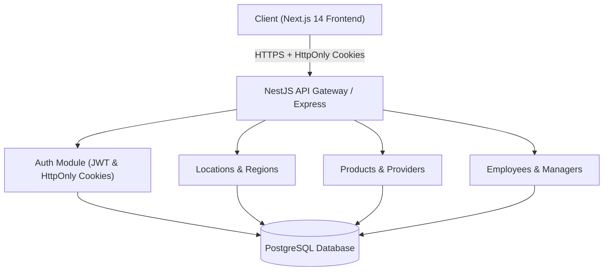

# OXXO Inventory Management API 🏪📦

Enterprise-grade retail inventory and multi-store management backend API, built with **NestJS**, **TypeScript**, **PostgreSQL**, and **TypeORM**. Designed under a Clean Modular Monolith architecture with role-based access control (RBAC), cookie-authenticated sessions, and automated Docker containerization.

> 🌐 **Companion Frontend Repository**: [OXXO Inventory Frontend (`oxxo-front`)](../oxxo-front/README.md) — Built with Next.js 14 (App Router), React Server Components, and Tailwind CSS.

---

## 🏛️ Architectural Overview

The application follows the **Modular Monolith** pattern with **Domain-Driven Design (DDD)** bounded contexts. Each business capability lives in an isolated, high-cohesion module containing its own entities, DTOs, services, and REST controllers.

```
src/
├── auth/           # Authentication, JWT strategy, bcrypt hashing, and cookie issuance
├── locations/      # Oxxo retail store branches, addresses, and physical locations
├── regions/        # Regional administrative groupings for stores
├── products/       # Inventory catalog, SKU tracking, pricing, and stock
├── providers/      # Supplier and vendor supply-chain management
├── employees/      # Store employees, shifts, and contact information
└── managers/       # Store managers, leadership hierarchy, and permissions
```



---

## ⚖️ Architectural Decisions & Trade-Offs

### 1. Modular Monolith vs. Microservices
* **Decision**: Implemented a single codebase divided into strict, decoupled domain modules rather than deploying independent microservices.
* **Benefits**: 
  - Zero inter-service network latency and guaranteed transactional consistency (ACID).
  - Streamlined continuous integration, local development, and unified debugging.
  - Single database connection pool and atomic schema migrations.
* **Trade-Off**: Scaling requires horizontal duplication of the entire monolith. However, modular boundaries ensure future extraction of high-load domains (e.g., `products` inventory) into standalone services without refactoring business logic.

### 2. TypeORM & PostgreSQL Relational Schema
* **Decision**: Modeled domain relationships (1:1, 1:N, N:M) using PostgreSQL with TypeORM declarative entities.
* **Benefits**:
  - Enforces relational data integrity at the database engine level (Foreign Keys, cascading rules, unique indexes).
  - Strongly typed data contracts through TypeScript decorators and auto-generated migrations.
* **Trade-Off**: Active-record/data-mapper ORM layers introduce query overhead. Mitigated by using parameterized TypeORM `QueryBuilder` for high-throughput listing endpoints and disabling eager loading across deep nested trees to prevent N+1 query bottlenecks.

### 3. Stateful HttpOnly Cookies vs. Header-based JWT Tokens
* **Decision**: Issue JWT tokens inside secure, `HttpOnly`, `SameSite=Lax` cookies rather than returning tokens in the JSON response body.
* **Benefits**:
  - Eliminates client-side token exposure to JavaScript, mitigating Cross-Site Scripting (XSS) credential theft.
  - Seamless integration with Server-Side Rendering (SSR) in Next.js Server Components (`cookies()` API).
* **Trade-Off**: Requires strict Cross-Origin Resource Sharing (CORS) whitelisting and credential delegation (`withCredentials: true`), making local multi-origin debugging (`127.0.0.1` vs. `localhost`) sensitive to cookie domain scoping.

### 4. Vitest & Oxlint Tooling Modernization
* **Decision**: Adopted Vitest for unit/integration testing and Oxlint for static analysis over traditional Jest and ESLint.
* **Benefits**:
  - Execution speed improvements exceeding 5x-10x for test suites and linting.
  - Native ESM and TypeScript compilation support without complex Babel or `ts-jest` transformers.
* **Trade-Off**: Requires custom Vite configuration paths (`vite-tsconfig-paths`) for NestJS dependency injection metadata reflection.

---

## 🚀 Tech Stack

| Layer | Technology | Purpose |
|---|---|---|
| **Runtime** | Node.js (ESM) | Non-blocking I/O runtime |
| **Framework** | NestJS 12 | Enterprise architectural backbone and DI container |
| **Language** | TypeScript 6 | Static type safety and strict schema contracts |
| **Database** | PostgreSQL 16 | Relational persistence engine |
| **ORM** | TypeORM | Entity relational mapping and migration management |
| **Security** | Bcrypt & JSONWebToken | Password hashing and signed auth payloads |
| **Validation** | `class-validator` & `class-transformer` | Request payload sanitization and DTO pipes |
| **Testing** | Vitest & Supertest | Unit, service mock, and E2E API verification |
| **Linter** | Oxlint | High-performance Rust-based static code analyzer |
| **Infra** | Docker & Docker Compose | Containerized local database and environment parity |

---

## 🛠️ Getting Started

### Prerequisites
- Node.js `>= 20.x`
- `pnpm` `>= 9.x`
- Docker & Docker Compose

### 1. Clone & Install Dependencies
```bash
git clone <repository-url>
cd ocso-project
pnpm install
```

### 2. Environment Configuration
Create a `.env` file in the project root:
```env
PORT=4000
DB_HOST=127.0.0.1
DB_PORT=5432
DB_USER=postgres
DB_PASSWORD=mysecretpassword
DB_NAME=oxxo_inventory
JWT_SECRET=super_secret_jwt_key_oxxo_enterprise
```

### 3. Spin Up Infrastructure
```bash
docker-compose up -d
```

### 4. Run Application
```bash
# Development watch mode
pnpm run start:dev

# Production build & run
pnpm run build
pnpm run start:prod
```

### 5. Run Test Suite
```bash
# Run unit & integration tests
pnpm run test

# Run tests with coverage report
pnpm run test:cov

# Run End-to-End (E2E) tests
pnpm run test:e2e
```

---

## 🔒 Security Best Practices Implemented
- **CORS Allowlist**: Configured strictly for authorized frontend origins with `credentials: true`.
- **Validation Pipe**: Global pipe with `whitelist: true` and `forbidNonWhitelisted: true` to prevent mass-assignment attacks.
- **Password Protection**: Multi-round Salt hashing with `bcrypt` before database persistence.
- **Session Lifespan**: Ephemeral tokens scoped with strict expiration policies.
